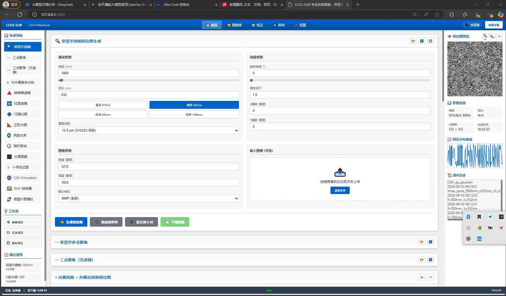
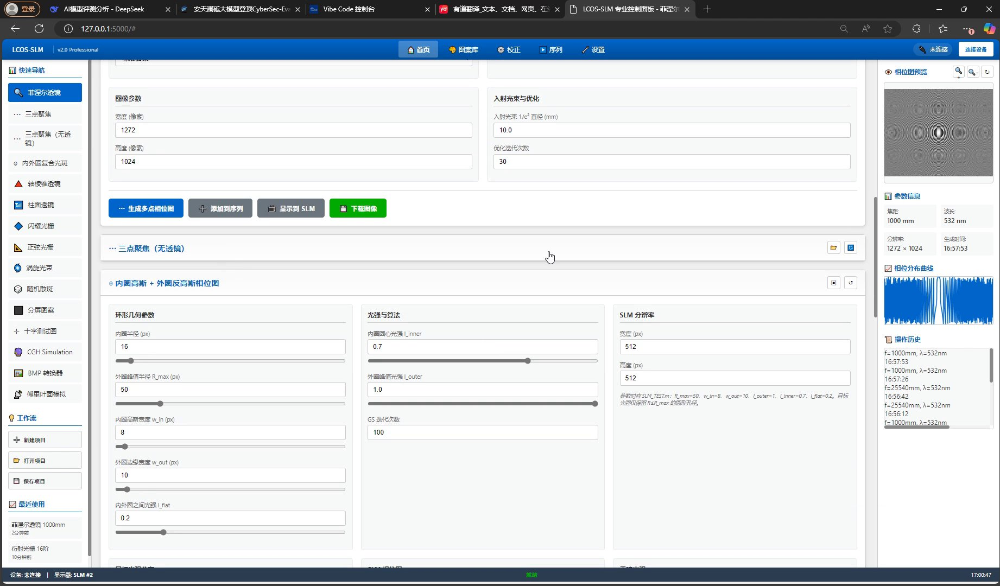
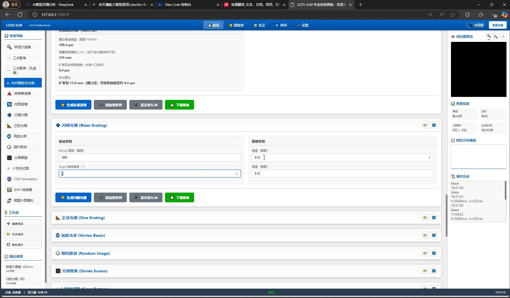
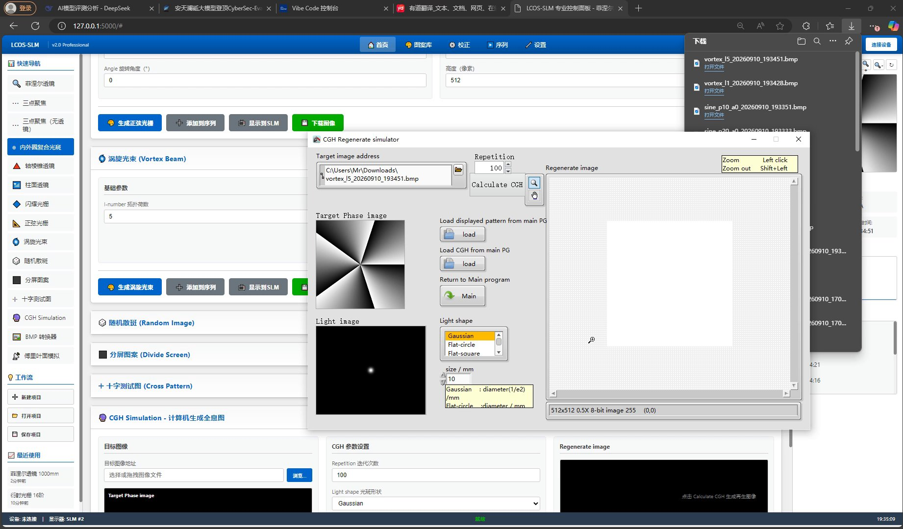
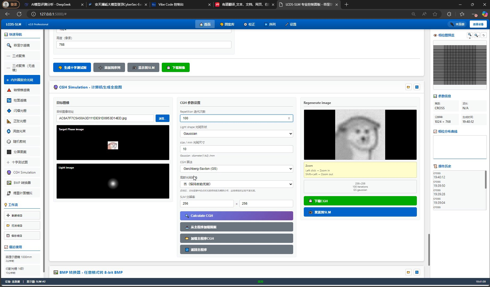
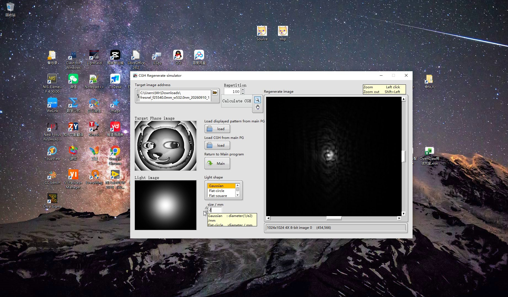
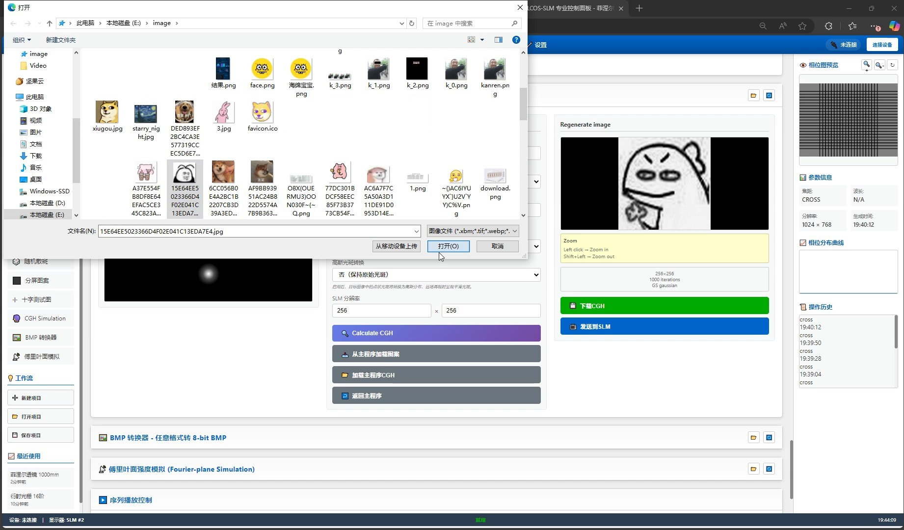
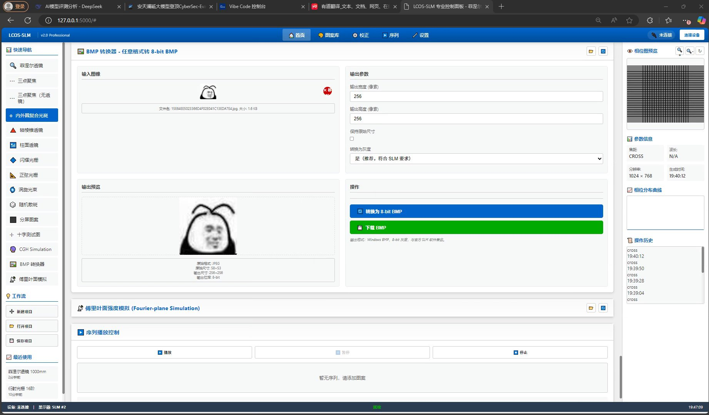

# LCOS-SLM 智能光场调控与光束整形系统

基于滨松 (Hamamatsu) LCOS-SLM X15223 系列的相位图设计、仿真与控制系统。支持网页端专业面板和独立桌面工具，用于生成菲涅尔透镜、超振荡焦线、内外圈复合光斑、CGH 全息图等相位图案。当前网页设备控制为模拟界面，项目尚未将图案下发流程接入厂商 SDK。



---

## 1. 硬件信息

| 参数 | 值 | 说明 |
|---|---|---|
| 设备型号 | Hamamatsu LCOS-SLM **X15223 系列** | 序列号 `LSH0804386` |
| 有效分辨率 | **1272 × 1024** px | 宽 × 高 |
| 像元间距 | **12.5 µm** | 已按官方手册修正 |
| 有效面积 | 15.9 mm × 12.8 mm | 1272×12.5µm / 1024×12.5µm |
| 相位调制 | 8-bit (0~255) | 0=0 rad，255=2π |
| 波长校正文件 | `CAL_LSH0804386_532nm.bmp` | 532 nm 标定 |
| 最大空间频率 | 40 lp/mm | 最小特征周期 ≥ 25 µm (≈2 px) |

> 参考文档：`Document/LEJ-B60004-4_ LCOS-SLM X15223Series_Operation_Manual.pdf`

---

## 2. 项目结构

```
SLMJomo/
├── web_app/                        # Web 主程序 (Flask)
│   ├── app.py                      # 后端核心：所有相位图生成算法
│   ├── templates/                  # HTML 页面
│   │   └── index_pro.html          # 专业版主界面
│   ├── static/                     # JS/CSS/图标
│   │   └── js/pro_main.js          # 前端交互逻辑
│   └── requirements.txt            # Python 依赖
├── SLM_PointsDesign/               # 独立桌面版工具
│   ├── double_ring_app.py          # “内外圈复合光斑” tkinter 版
│   ├── Run.bat                     # 一键启动 (自动检测并安装依赖)
│   └── SLM_params_reference.txt    # SLM 参数清单 (供 gpt-image-2 使用)
├── assets/                         # README 配图与案例截图
│   └── screenshots/                # 系统界面截图
├── Document/                       # 官方手册与论文
│   ├── LEJ-B60004-4_ LCOS-SLM X15223Series_Operation_Manual.pdf
│   └── Nature/                     # 相关参考文献
├── Installer/                      # 32-bit SDK 安装包
├── Installer_for_64bit_SDK/        # 64-bit SDK 安装包
├── 视频闭环_基于LCOS-SLM智能光场调控与光束整形系统综合/
│   ├── SLM相位图设计系统.mp4       # 系统演示视频
│   └── 基于LCOS-SLM智能光场调控与光束整形系统综合报告.docx
└── README.md                       # 本文件
```

---

## 3. 功能模块

### 3.1 Web 端专业面板 (`web_app/`)

访问地址：`http://127.0.0.1:5000`

| 模块 | 功能 | 关键参数 |
|---|---|---|
| **菲涅尔透镜** | 生成聚焦相位图 | 焦距 100~98000 mm，波长 355~1064 nm |
| **菲涅尔多点聚焦** | 多焦点光束 | 焦点数、焦点间距、入射光直径 |
| **三点聚焦 (无透镜)** | 纯分束三焦点 | 算法 analytic / GS |
| **内外圈复合光斑** | 内高斯圆 + 外反高斯环 | ri, ro, w_in, w_out, I_inner, I_outer, I_flat |
| **轴棱锥透镜 (Axicon)** | 贝塞尔光束 | radius |
| **柱面透镜 (Cylindrical)** | 线聚焦 | focal_length, angle |
| **闪耀光栅 (Blaze)** | 光束偏转 | period, angle |
| **正弦光栅 (Sine)** | 衍射分束 | period, angle |
| **涡旋光束 (Vortex)** | 携带轨道角动量 | 拓扑荷 l_number |
| **随机散斑 (Random)** | 随机相位图 | seed |
| **分屏图案 (Divide)** | 两半屏不同相位 | grayvalue1, grayvalue2 |
| **十字测试图 (Cross)** | 标定/测试条纹 | 相位、宽度、间距、数量 |
| **CGH Simulation** | 由目标图迭代生成全息相位 | GS/OC 算法、入射光形状、迭代次数 |
| **BMP 转换器** | 任意图转 8-bit BMP | 输出尺寸、反色 |
| **傅里叶强度模拟** | 预览相位图的远场强度 | 彩色/对数/原始强度分布 |
| **序列播放控制** | 多图轮流播放 | 添加到序列、播放/暂停 |

### 3.2 独立桌面版 (`SLM_PointsDesign/`)

针对“内外圈复合光斑”模块的轻量桌面版，不依赖 Flask，双击 `Run.bat` 即可启动。

预览面板：
1. 目标光强
2. SLM 相位图
3. 重建光强
4. 彩色强度分布
5. 目标光强截面曲线（底部）

---

## 4. 系统案例展示

以下截图与视频截帧来自系统实际运行界面。

### 4.1 菲涅尔透镜与多点聚焦


*菲涅尔透镜相位图生成界面，焦距 25540 mm，波长 532 nm*


*菲涅尔多点聚焦与内外圈复合光斑模块*

### 4.2 高级相位结构


*超振荡焦线参数界面与闪耀光栅预览*


*涡旋光束生成与 CGH Regenerate simulator 独立程序*

### 4.3 CGH 计算机生成全息图


*CGH Simulation 模块：上传任意目标图像进行迭代优化*


*CGH Regenerate simulator：载入相位图并模拟重建像*

### 4.4 工具与仿真


*BMP 转换器：任意图片转为 SLM 可用的 8-bit BMP*


*傅里叶强度模拟：预览相位图远场彩色/对数强度分布*

### 4.5 演示视频

完整操作演示见：

```
视频闭环_基于LCOS-SLM智能光场调控与光束整形系统综合/SLM相位图设计系统.mp4
```

时长约 29 分钟，涵盖从参数设置、相位生成、CGH 优化到下载下发 SLM 的完整工作流。
当前网页版本的设备连接与发送仍是模拟界面；该历史演示不代表当前已集成真实 SDK 下发。

---

## 5. 安装与运行

### 5.1 Web 端

```bash
cd web_app
python -m pip install -r requirements.txt
python app.py
```

For the versions tested on Windows x64 with CPython 3.12, use `python -m pip install -r requirements-win-py312-x64.lock` from `web_app` to install the pinned Web App runtime.

浏览器打开 `http://127.0.0.1:5000`

### 5.2 独立桌面版

进入 `SLM_PointsDesign` 文件夹，双击：

```
Run.bat
```

脚本会自动检测 Python 环境并安装缺失依赖（`numpy`、`Pillow`）。

---

## 6. 快速开始

1. **选择模块**：左侧“快速导航”点击目标模块（如“菲涅尔透镜”）。
2. **设置参数**：输入焦距、波长、画布尺寸等。
3. **生成相位图**：点击“生成相位图”。
4. **预览与下载**：右侧查看相位预览，点击“下载图像”保存 BMP。
5. **设备状态**：网页面板中的连接与发送操作仅用于模拟；真实 SLM 下发尚未接入。
6. **序列播放**：将多个图案“添加到序列”，在“序列播放控制”中播放。

---

## 7. 关键参数参考

### 菲涅尔透镜焦距上限

基于像元间距 12.5 µm、1272×1024，单环带极限：

```
f_max = r² / (2λ)
```

取对角半径 `r = √(636²+512²) × 12.5 µm ≈ 10.21 mm`，λ=532 nm：

```
f_max ≈ 98,000 mm (约 98 m)
```

超过此值后图样中环带稀疏，逐渐被量化噪声淹没。

### 波长与像元间距

| 波长 | 用途 |
|---|---|
| 473 nm | 蓝光 |
| 532 nm | 绿光（默认，已有该校正文件） |
| 633 nm | 红光 |
| 1064 nm | 红外 |

像元间距：**统一使用 12.5 µm**（X15223 实际值）。

---

## 8. 注意事项

1. **像元间距已修正**：旧版代码和 UI 中曾存在 1.25 µm / 25 µm 的误差，当前已全部修正为 12.5 µm。若使用旧生成图，请注意焦距/尺寸换算。
2. **最小特征尺寸**：避免生成 < 2 px 的相位条纹，否则会被 SLM 欠采样。
3. **8-bit 量化**：相位是 0~255 整数，连续相位到量化相位会引入误差，远场模拟已考虑该因素。
4. **入射光直径**：入射光斑越小，衍射发散角越大，实际焦点尺寸越大。建议入射光尽量充满 SLM 口径以获得最小焦点。
5. **CGH 输入图**：上传的目标图应为灰度图，建议 256×256 或 512×512；最终生成的相位图会自动适配 SLM 分辨率。

---

## 9. 相关文档

- `Document/LEJ-B60004-4_ LCOS-SLM X15223Series_Operation_Manual.pdf` — 官方硬件手册
- `Document/如何通过USB直接控制+SLM--X15223系列.pdf` — USB 控制说明
- `Document/K51L-0398D_USB_SLMcontrol manual.pdf` — 控制软件说明
- `视频闭环_基于LCOS-SLM智能光场调控与光束整形系统综合/SLM相位图设计系统.mp4` — 系统演示视频
- `SLM_PointsDesign/SLM_params_reference.txt` — 供 gpt-image-2 使用的参数清单

---

## 10. 开发信息

- 主要语言：Python + JavaScript
- 后端框架：Flask
- 前端：原生 HTML/JS + Bootstrap
- 独立桌面版：tkinter + numpy + Pillow
- 核心算法：Gerchberg-Saxton (GS)、FFT、角谱法
- SDK 冒烟检查：`USB_Control_SDK/project/main.py` 仅在直接运行时加载 DLL 并打开设备；模块导入不访问硬件，设备读取失败时也会尝试关闭。可在 `USB_Control_SDK/project/` 运行 `python -m unittest test_sdk_loader test_sdk_smoke` 做无硬件测试。该脚本只读取设备序列号和温度，不会下发相位图。

---

*整理日期：2026-09-10*
